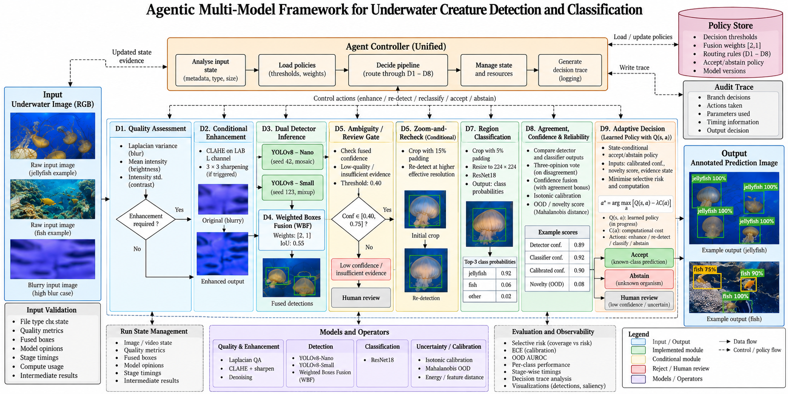
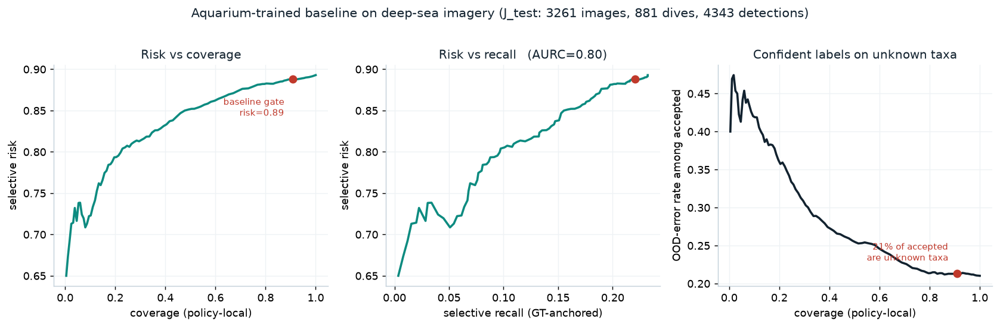
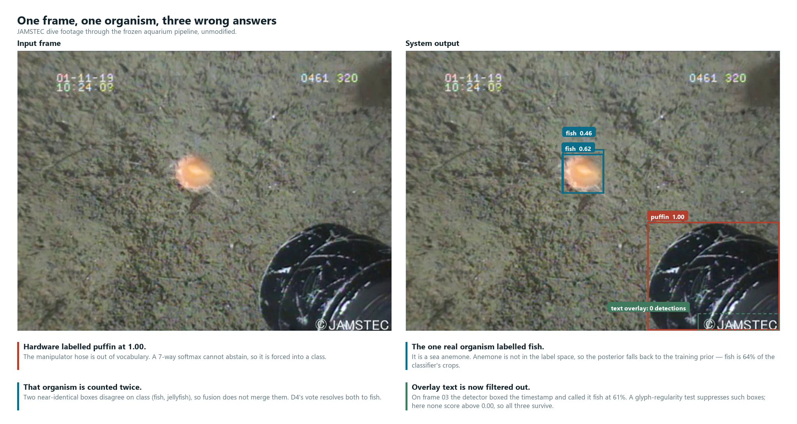

<div align="center">

# Deep-Sea Creature Detection & Classification

**An agentic multi-model pipeline for underwater imagery, built to know when it doesn't know.**

[](https://ajgodwin-deepseaai.static.hf.space/)


[Live demo](https://ajgodwin-deepseaai.static.hf.space/) ·
[Findings](#what-we-found) ·
[How it works](#how-it-works) ·
[Quick start](#quick-start) ·
[Results](experiments/RESULTS.md) ·
[Docs](#documentation)

<br>



</div>

---

## Overview

Marine biologists record thousands of hours of footage from robotic submersibles, and
someone has to identify every organism in it. This project is an automated recogniser
for that footage: two YOLOv8 detectors fused with Weighted Boxes Fusion, a ResNet-18
species classifier, and a controller that decides, per image, whether to enhance it,
look closer, or decline to answer.

The question it is built around is not *"how accurate is it?"* but
**"does it know when it doesn't know?"** A recogniser that labels an unfamiliar
creature as "fish" with 99% confidence puts a wrong record into a scientific database
that nobody can tell apart from a real observation.

This repository holds the pipeline, the web application, and the evaluation that tests
it honestly: dive-disjoint splits, bootstrap confidence intervals, and a test set that
was read once.

> **Scope.** This release covers still images. Video is planned as a separate stage.

## What we found

Trained and validated on aquarium imagery, the pipeline looks strong. Deployed
unchanged on 8,151 real deep-sea frames, it is not. The measurements below are from
[`experiments/RESULTS.md`](experiments/RESULTS.md), with the protocol that produced
them in [`experiments/PROTOCOL.md`](experiments/PROTOCOL.md).

| | Result |
|---|---|
| In its own domain (aquarium) | mAP@0.50 = **0.78** |
| Deployed on deep-sea frames | selective risk **0.888** [0.876, 0.900]: wrong about nine times in ten |
| Share of deep-sea organisms outside the label space | **66.1%** |
| Does raising the confidence threshold help? | **No.** Risk stays near 0.89, and the most confident detections are among the most likely to be confidently wrong |
| Confidence as a novelty signal | at chance (AUROC 0.44 to 0.53) |
| Calibration (isotonic) | ECE **0.467 → 0.016** |
| Novelty detection, retrained features with energy score | AUROC 0.553 → **0.806** |
| Learned accept/abstain policy, risk at 30% coverage | 0.846 → **0.776**, 95% CI on the difference [+0.049, +0.093] |
| Detector retrained on deep-sea data (3 seeds) | mAP@0.50 = **0.688 ± 0.005** |

Three findings carry the most weight:

1. **Confidence carries almost no information about correctness under domain shift.**
   No threshold makes the system reliable. The information needed to recognise
   something new *is* still inside the network; the final softmax discards it.
2. **None of the four hand-written adaptive actions earns its cost.** Forced-action
   measurement shows image enhancement is actively harmful, zoom is inert, and the
   three-opinion vote is no better than trusting the classifier.
3. **The supplied dataset splits leak.** 57.3% of the supplied test images share a dive
   with training images, so every result here uses dive-disjoint re-splits.

<table>
<tr>
<td width="50%"></td>
<td width="50%"></td>
</tr>
<tr>
<td align="center"><sub>Raising the threshold does not reduce risk.</sub></td>
<td align="center"><sub>One organism, three wrong answers, each with a different cause.</sub></td>
</tr>
</table>

More figures: [learned policy](docs/images/learned-policy.png) ·
[novelty detection](docs/images/ood-features.png) ·
[degradation](docs/images/degradation.png) ·
[action effects](docs/images/action-effects.png) ·
[overlay-text filter](docs/images/text-filter.png)

## How it works

```
image ─► quality check ─► [enhance?] ─► YOLOv8-n ┐
                                        YOLOv8-s ┴─► Weighted Boxes Fusion ─► text filter ─► ResNet-18 ─► confidence ─► accept / abstain
                                                                                                                │
                                                                          decision trace (every branch taken) ◄─┘
```

**Perception always runs.** Two detectors with different seeds and augmentation are
fused by Weighted Boxes Fusion, which averages overlapping boxes instead of discarding
one, so agreement between models is kept as evidence. A separate ResNet-18 then
classifies each box independently; a disagreement between detector and classifier is
itself a signal.

**Four decision points** sit around it:

| | Decision | Rule |
|---|---|---|
| D1 | Is the image usable? | CLAHE if brightness < 50 or > 200, or contrast < 30; sharpen if blur < 100 |
| D2 | Is there enough evidence to analyse at all? | Refuse if blur < 5.0 or no box reaches 0.40 |
| D3 | Is this detection ambiguous? | Zoom and re-detect inside the 0.40 to 0.75 band |
| D4 | Do detector and classifier agree? | Otherwise a third opinion and a majority vote |

**An uncertainty layer** turns raw scores into something usable: isotonic calibration,
a novelty score from the feature space, and a learned accept/abstain policy that
weighted novelty about five times more heavily than confidence.

**Everything is traceable.** Each request returns a `decision_trace` listing every
action taken, and the web interface renders it as a timeline.

**Overlay text is filtered out.** Submersible video burns a timestamp, depth and
watermark into the pixels. Contrast enhancement made those glyphs detectable, and the
classifier named them as fish. [`text_overlay.py`](text_overlay.py) rejects boxes that
sit on text, using glyph regularity rather than position, and
[`experiments/verify_text_filter.py`](experiments/verify_text_filter.py) guards it.

## Try it

**Online.** The [live demo](https://ajgodwin-deepseaai.static.hf.space/) replays the
recorded output of the real pipeline for its built-in samples, including real deep-sea
frames the system gets wrong. It does not run the models itself. See
[`docs/DEPLOYMENT.md`](docs/DEPLOYMENT.md) for how to connect it to a live backend.

**Locally.** The full app, with your own images, runs from one process:

```bash
uvicorn webapp:app --port 8000      # then open http://localhost:8000
```

## Quick start

Requires **Python 3.10+**. A CUDA GPU is optional; the code falls back to CPU.

```bash
git clone https://github.com/keertanvasani/Final-Project-G032.git
cd Final-Project-G032

python -m venv venv
source venv/bin/activate            # Windows: venv\Scripts\activate
pip install -r requirements.txt
```

`data/`, `classifier_data/` and `models/` are gitignored, so a fresh clone has code but
no dataset or weights. Produce them in order:

```bash
export ROBOFLOW_API_KEY="your_key"  # free key from https://app.roboflow.com/settings/api
python download_dataset.py          # Aquarium Combined, 638 images, 7 classes
python prepare_classifier_data.py   # crops for the classifier
python train_yolo.py                # YOLOv8-n and YOLOv8-s
python train_classifier.py          # ResNet-18
uvicorn webapp:app --port 8000
```

Without trained weights the server falls back to generic COCO detectors. On an NVIDIA
RTX 50-series GPU, install a CUDA 12.8 PyTorch build first; see
[`docs/MIGRATION.md`](docs/MIGRATION.md).

```bash
curl http://localhost:8000/health
curl -X POST http://localhost:8000/predict -F "file=@image.jpg"
```

The request and response formats are in [`docs/API.md`](docs/API.md).

## Repository layout

```
.
├── main.py                 FastAPI application (/health, /predict)
├── webapp.py               mounts the web UI on the same app
├── pipeline.py             detection, fusion, classification, annotation
├── agent_controller.py     entry points: run_agentic_pipeline (app), run_perception (evaluation)
├── agentic/                the agent: Observe → Decide → Act → Verify, once per image
│   ├── tools.py            enhance, zoom, classify, vote (D1, D3, D4)
│   ├── policy.py           rule policy, plain-model policy, fallback chain
│   ├── verifier.py         text filter, refuse gate (D2), calibration, Known/Unknown
│   └── loop.py             the loop and its guardrails (time budget, call limit)
├── ensemble.py             Weighted Boxes Fusion
├── classifier.py           ResNet-18 species classifier
├── text_overlay.py         burned-in telemetry text filter
├── config.py               every threshold and path
├── train_yolo.py · train_classifier.py · download_dataset.py · prepare_classifier_data.py
├── frontend/               the web interface (no build step)
├── experiments/            evaluation: protocol, harness, calibration, OOD, results
│   ├── PROTOCOL.md         the binding evaluation specification
│   ├── RESULTS.md          consolidated, tagged results
│   ├── eval/               evaluation harness and metrics
│   └── results/            cached result files behind the figures
├── deploy/                 static Hugging Face Space and live-demo tunnel script
└── docs/                   API, deployment, troubleshooting, web app guide, images
```

## Documentation

| | |
|---|---|
| [`experiments/RESULTS.md`](experiments/RESULTS.md) | Every result, with the split it came from and how it was measured |
| [`experiments/PROTOCOL.md`](experiments/PROTOCOL.md) | Evaluation protocol and pre-registered hypotheses |
| [`experiments/README.md`](experiments/README.md) | How to reproduce the evaluation, in dependency order |
| [`docs/API.md`](docs/API.md) | Endpoints, response format, configuration table |
| [`docs/DEPLOYMENT.md`](docs/DEPLOYMENT.md) | The hosted demo and the live-backend tunnel |
| [`docs/WEBAPP.md`](docs/WEBAPP.md) | Web interface layout and UI states |
| [`docs/TROUBLESHOOTING.md`](docs/TROUBLESHOOTING.md) | Common errors and fixes |
| [`docs/MIGRATION.md`](docs/MIGRATION.md) | Moving the project to a new GPU machine |
| [`docs/DEMO_SCRIPT.md`](docs/DEMO_SCRIPT.md) | Talking points for a live demonstration |

## Limitations

- **Photos only.** Video is future work. Several expected gains, such as a false
  detection not persisting across frames, are hypotheses, not measurements.
- **The deployed models are trained on aquarium data.** Deep-sea frames are out of
  domain, and the demo is honest about that. The retrained detector reaches 0.688 mAP,
  well below the in-domain 0.78.
- **The adaptive actions are not validated.** Enhancement, zoom and the majority vote
  did not improve accuracy when measured. They remain in the pipeline as the documented
  baseline that a learned policy is compared against.
- **The value model Q(s, a) is not built.** Zoom produces too few outcome changes to
  fit it honestly, so it was not reported.

## Team

**Team 32** · Course 23CSE498, Project Phase 2 · Department of CSE

| | Student | Register number |
|---|---|---|
| 1 | Adhi Krishna | CB.SC.U4CSE23702 |
| 2 | Keertan Vasani | CB.SC.U4CSE23723 |
| 3 | Rishinath S Kurup | CB.SC.U4CSE23741 |
| 4 | Saurav Gopinath | CB.SC.U4CSE23546 |
| 5 | Amal Godwin J | CB.SC.U4CSE23407 |

**Guide:** Dr Baskar A, Assistant Professor, Department of CSE

## Data, licences and credits

- **Aquarium Combined**, used to train the baseline detectors and classifier:
  [Roboflow Universe](https://universe.roboflow.com/brad-dwyer/aquarium-combined),
  638 images, **CC BY 4.0**.
- **JEDI deep-sea frames**, used for evaluation and shown in the demo: JAMSTEC JEDI
  dataset, © JAMSTEC, licensed
  [**CC BY-NC-SA 4.0**](https://creativecommons.org/licenses/by-nc-sa/4.0/deed.en).
  Frames are shown unmodified; annotated results are adaptations shared under the same
  licence. **Non-commercial use only.** The dataset is not redistributed here beyond the
  demo samples.
- **Software:** [Ultralytics YOLOv8](https://github.com/ultralytics/ultralytics),
  [ensemble-boxes](https://github.com/ZFTurbo/Weighted-Boxes-Fusion),
  [PyTorch](https://pytorch.org), [FastAPI](https://fastapi.tiangolo.com).
- **Source code:** a licence has not been chosen yet. Please contact the team before
  reusing it.
